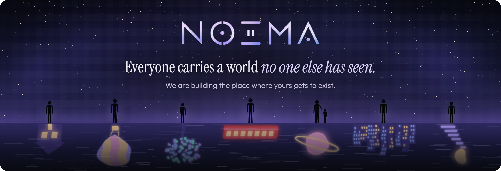
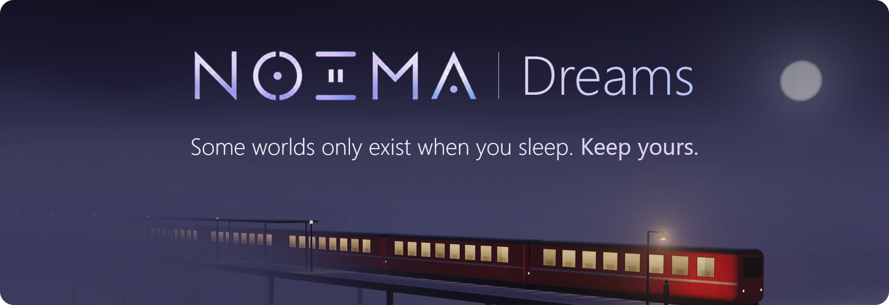
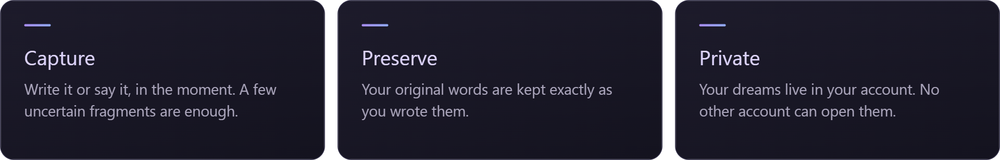
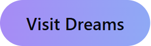
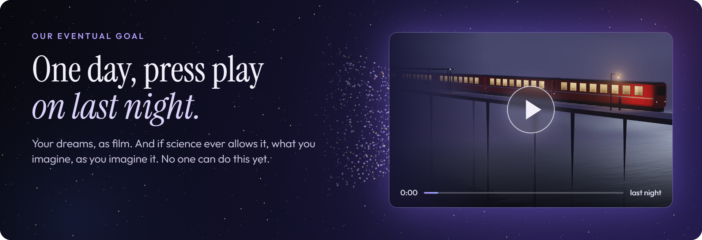

  

<h3 align="center">The inner world has never had a home.</h3>

  Every person carries things no camera has ever caught: a street that never existed, 
  a voice from years ago, an idea that came at 3 a.m. and was gone by breakfast. 
  Almost all of it disappears, and no one ever knows it was there.

  NOEMA is being built so that it doesn't. We want a dreamful, deeply personal experience for every person who opens it, 
  and for them to feel what is true: what they have seen could not have come from anyone else, and the world is richer for it.

  <b>Stay close to this early, and you help decide what it becomes.</b>

 

  

<h3 align="center">It begins with Noema Dreams.</h3>

  Dreams fade quickly. Noema Dreams gives them a place to land: 
  write or record what you remember, then come back to it whenever you want.

  

  

Currently open by invitation.

 

  

<h3 align="center">This is what we are walking toward.</h3>

  Picture waking up, saying a few broken words about a place you just left, 
  and then watching it: the light, the street, the face you almost remember, moving again.

  That is our eventual goal: <b>your dreams, as video.</b>

  Beyond it sits the hardest question we know. Every thought you have arrives with pictures only you can see. 
  If science ever makes it possible, we want those pictures to reach the outside, as they form, and stay yours.

  No one can do this today, and neither can we. It may take many years. 
  We are starting with what is real, and we are not planning to stop there.

 

<h3 align="center">Help give the unseen somewhere to go.</h3>

  NOEMA is very small and very early. We can't pay salaries yet, and we will tell you exactly what we can offer before you give us an hour of your time. 
  If you would rather be here at the first page than arrive after the story is written, we would love to hear from you.

  

 

  Today, NOEMA works only from what you choose to write or record. It does not read minds or record dreams. 
  © 2026 Hibon Technologies. All rights reserved.

